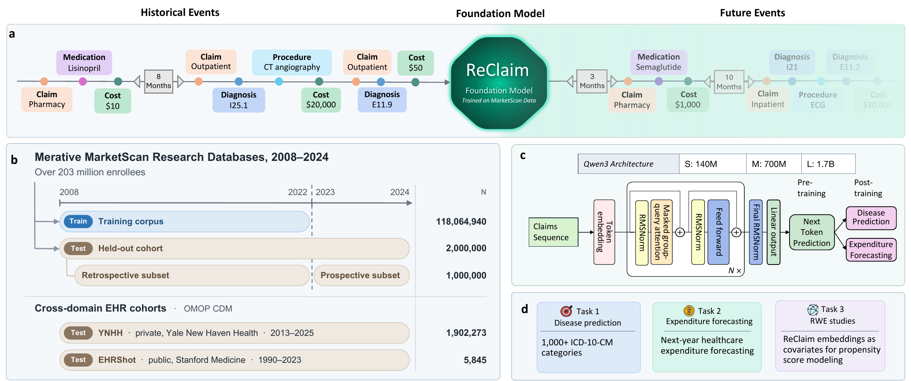

# ReClaim

This repository contains code for ReClaim, a family of generative transformer
models for longitudinal medical claims trajectories.

ReClaim is described in the paper
[Foundation Models to Unlock Real-World Evidence from Nationwide Medical Claims](https://arxiv.org/abs/2605.02740).
The paper studies administrative claims as a substrate for healthcare foundation
models, training ReClaim on nationwide MarketScan claims trajectories and
evaluating it across disease-onset prediction, expenditure forecasting, and
real-world evidence analyses.



## Codebase Overview

The repository is organized as a research pipeline:

| Path | Purpose |
|------|---------|
| `preprocessing/` | Standardize medical codes (`vocab_mapping/`) and convert MarketScan claims (`pipeline_marketscan/`, including the train/val/test split) and EHRSHOT and YNHH OMOP data (`pipeline_omop/`) into monthly token sequences; local paths are set once in `env.sh`. |
| `pre-training/` | Build Hugging Face tokenizers, prepare pre-training datasets, and pre-train Qwen-style causal language models; includes the shared trainer and configuration. |
| `downstream_tasks/disease_prediction/` | Prepare disease instruction data and fine-tune models under `post-training/`, prepare case/control cohorts, run inference, and compute disease-onset AUCs; `results/` holds released per-disease tables and `output/figures/` holds rendered figures and summaries. |
| `downstream_tasks/expenditure_forecasting/` | Forecast next-year expenditure: pre-trained ReClaim via Monte-Carlo simulation, post-trained one-token readout, and LightGBM; `output/` regenerates the paper's tables and figures. |
| `downstream_tasks/rwe_support/` | Real-world evidence with ReClaim embeddings for confounding adjustment: a known-effect hdPS benchmark on MarketScan (`study1/`) and a GLP-1RA target trial emulation on MarketScan claims and YNHH EHR (`study2/`); `output/` regenerates the paper's RWE tables and figure. |
| `visualization/` | Paper figure scripts, one subfolder per topic: `disease_prediction/` draws the disease-onset panels from released AUC tables; `disease_embeddings/` projects each model's learned disease representations with UMAP and t-SNE, coloured by ICD-10 chapter, and scores how well that geometry recovers the chapters. |
| `figures/` | The current manuscript framework figure in PDF and PNG. Task-specific results and figures live under their respective `downstream_tasks/` folders. |

## Downstream Results and Figures

- **Disease prediction:** [EHRSHOT AUC tables](downstream_tasks/disease_prediction/results/ehrshot/)
  and [figures with reproduction instructions](downstream_tasks/disease_prediction/output/README.md).
- **Expenditure forecasting:** [tables and figures](downstream_tasks/expenditure_forecasting/output/README.md).
- **RWE support:** [tables and figures](downstream_tasks/rwe_support/output/README.md).

## Workflow

At a high level, the project follows this order:

1. Generate medical vocabulary mappings under `preprocessing/vocab_mapping/`.
2. Preprocess raw claims (`preprocessing/pipeline_marketscan/`) or OMOP-style EHR data
   (`preprocessing/pipeline_omop/`) into monthly token sequences.
3. Build a tokenizer and pre-train ReClaim models under `pre-training/`.
4. Prepare disease instruction data and post-train under
   `downstream_tasks/disease_prediction/post-training/`.
5. Run downstream evaluations for disease onset, cost forecasting, and RWE support.

Each major folder has its own README with the expected inputs, local path
configuration, and stage-by-stage commands.

## Notes

Large raw datasets, generated mappings, model checkpoints, logs, and most
intermediate outputs are not included in this repository. Many scripts are
designed for a Slurm/HPC environment and require local paths or environment
variables to be configured before running.

## Citation

If you use this code, please cite the ReClaim paper:

```bibtex
@misc{ma2026reclaim,
  title = {Foundation Models to Unlock Real-World Evidence from Nationwide Medical Claims},
  author = {Ma, Fan and Liu, Yuntian and Lan, Xiang and others},
  year = {2026},
  eprint = {2605.02740},
  archivePrefix = {arXiv},
  primaryClass = {cs.AI}
}
```
