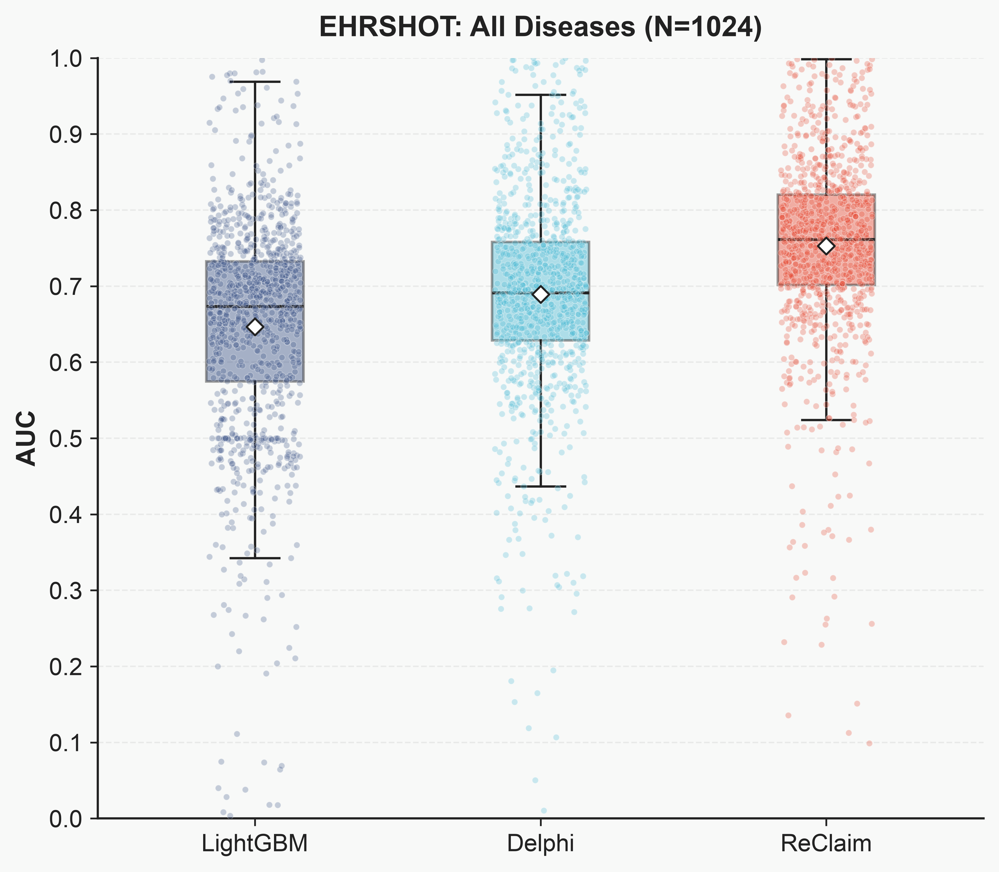
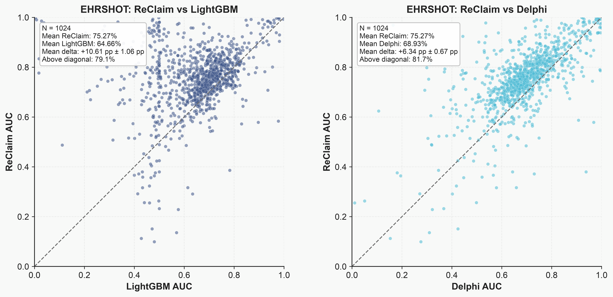

# Disease prediction outputs

The released EHRSHOT results and their rendered figures live with the disease
prediction task. Plotting code remains in
[`visualization/disease_prediction/`](../../../visualization/disease_prediction/).

| Path | Contents |
|---|---|
| [`../results/ehrshot/`](../results/ehrshot/) | Per-disease AUC tables for ReClaim-L, Delphi, LightGBM, GPT-2 and Llama-3.1, keyed by ICD-10 code. |
| [`figures/ehrshot/ehrshot_box.pdf`](figures/ehrshot/ehrshot_box.pdf) | EHRSHOT AUC distributions for ReClaim-L, Delphi and LightGBM. |
| [`figures/ehrshot/ehrshot_paired.pdf`](figures/ehrshot/ehrshot_paired.pdf) | Per-disease comparisons of ReClaim-L against the two baselines. |
| [`figures/ehrshot/ehrshot_summary.csv`](figures/ehrshot/ehrshot_summary.csv) | Means, paired differences, confidence intervals and win fractions for the plotted comparisons. |





From the repository root, with `matplotlib`, `numpy` and `pandas` installed:

```bash
bash visualization/disease_prediction/run_ehrshot_figures.sh
```

Set `PYTHON` to choose an interpreter. The wrapper resolves its inputs and default
output directory relative to the repository, so it also works from another working
directory. An optional first argument selects a different output directory.

All disease-prediction plotting scripts default to this task's `output/figures/`
directory; the EHRSHOT wrapper uses its `ehrshot/` subdirectory. Other datasets
require locally supplied AUC tables, as described in the plotting README.
