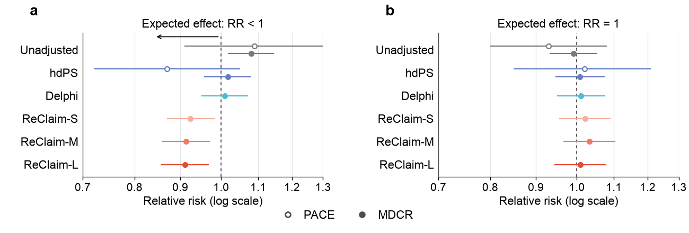

# RWE outputs

Formats the modules' results into the paper's RWE tables and figures; nothing is re-estimated.

```bash
PYTHON_FIGURE=/path/to/python-with-matplotlib bash output/scripts/make_all.sh
```

| Script | Writes |
|---|---|
| `scripts/study1_tables.py` | `tables/s1_*` (Study 1), from `study1/results/mdcr/` |
| `scripts/study2_tables.py` | `tables/s2_*` (Study 2), from `study2/*/results/` (mainly `summary_outcomes.csv`, `summary_diagnostics.csv`, `summary_expert_balance.csv`) |
| | cohort tables (`s1_cohort_*`, `s2_cohorts`) aggregate the person-level `intermediate/` cohort files; skipped when those are absent (the copies in `tables/` are kept) |
| `scripts/rwe_main_figure.py` | `figures/rwe_main_figure.{pdf,png}`: current compact manuscript Figure 6, from the released `tables/s1_ladder_{positive,negative}.csv` |
| `scripts/rwe_study1_doubly_robust.py` | `figures/rwe_study1_doubly_robust.{pdf,png}`: Study 1 doubly robust analysis (as `tables/s1_doubly_robust_*`) |
| `scripts/common.py` | paths, labels, and the reference studies' published values (with their sources) |

To redraw the main figure from the bundled aggregate tables alone:

```bash
python output/scripts/rwe_main_figure.py
```

This uses the manuscript's 6.5 x 2.2 inch layout, larger labels, and reported
RR / 95% CI values. It does not require the unpublished `study1/results/` files.
Pass `--out_dir /path/to/figures` to select another output directory.



Tables are written as CSV plus a Markdown copy. The figures were rendered with matplotlib 3.11.2.

Specification names: `crude` Unadjusted, `demo` Demographics, `paper` Expert (the reference's covariate set),
`hdps` hdPS, `delphi-only` Delphi, `reclaim-{s,m,l}-only` ReClaim-S/M/L.

Design definitions are read from the modules: negative-control outcomes in `study2/*/lookup_table/`
(`glp_nco_reference24.txt`, `glp_nco_icd_0225.csv`; not distributed, see the `study2` READMEs), the protocol
and covariates in `study2/*/config/tte_glp1_psych.yaml`.
